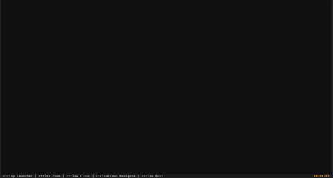

# Rune Desktop Environment

[](https://www.python.org/)
[](https://www.rust-lang.org/)
[]()
[](LICENSE)

Rune is a lightweight Text User Interface (TUI) Desktop Environment and window multiplexer built on top of [Textual](https://github.com/Textualize/textual). Designed for Linux virtual consoles (TTY) and modern terminal emulators, Rune provides a fast, keyboard-driven workspace without graphical dependencies.



## Features

- **Tiling Window Management**: Multi-window horizontal workspace with directional focus navigation and full-screen zoom (`Ctrl + Z`).
- **IPC Application Spawning**: Built-in Unix domain socket server to open applications directly from shell scripts or terminal sessions.
- **Single-Instance Safety**: Process conflict prevention using an exclusive lockfile (`/tmp/rune.lock`).
- **Rust-Accelerated Media Rendering**: TrueColor half-block ASCII rendering engines for smooth image and video playback in raw TTY environments.

## Integrated Applications

- **Terminal (`PTYWidget`)**: Pseudo-terminal emulator powered by a native Rust VT100 parser with full ANSI support.
- **Text Editor (`TextEditor`)**: Code and plain-text editor with syntax highlighting, live modification indicators, and file management dialogs.
- **Image Viewer (`ImageViewer`)**: Static image and animated GIF viewer with color-batching ASCII rendering.
- **Music Player (`MusicPlayer`)**: Audio player backed by `mpv` with real-time ASCII waveform visualization.
- **Video Watcher (`VideoPlayer`)**: Video playback syncing OpenCV frames with MPV audio, featuring live progress bar and volume controls.

## System Keybindings

| Keybinding | Action |
| :--- | :--- |
| `Ctrl + P` | Open / Toggle Application Launcher |
| `Ctrl + Z` | Toggle Zoom on Active Window |
| `Ctrl + W` | Close Active Window |
| `Ctrl + Up` | Focus window above |
| `Ctrl + Down` | Focus window below |
| `Ctrl + Left` | Focus window on the left |
| `Ctrl + Right` | Focus window on the right |

### Video Player Controls

| Keybinding | Action |
| :--- | :--- |
| `Space` | Toggle Play / Pause |
| `Left` / `Right` | Seek backward / forward (5s) |
| `Up` / `Down` or `+` / `-` | Adjust volume (+5% / -5%) |
| `m` | Toggle mute |

## Project Structure

```
├── assets/                    # Demo media and visual assets
├── bin/
│   └── rune                   # External IPC CLI helper
├── core/
│   ├── application_launcher.py# Search overlay modal for system apps
│   ├── application_manager.py # Window registry and lifecycle supervisor
│   ├── image_viewer.py        # ASCII image & GIF renderer
│   ├── music_player.py        # MPV audio player with visualizer
│   ├── native.py              # Native Rust engine bindings & fallbacks
│   ├── pty_widget.py          # Native terminal multiplexer backend
│   ├── video_player.py        # Video player with synchronized audio
│   ├── registry.py            # Application registry dictionary
│   ├── rune.py                # Main application class
│   ├── taskbar.py             # Status bar and system clock
│   ├── text_editor.py         # Code editor with modal dialogs
│   ├── window.py              # Window container base class
│   └── workspace.py           # Horizontal docking workspace
├── crates/
│   └── native/
│       ├── src/               # Rust source code (VT100 & image engine)
│       ├── Cargo.toml         # Rust package configuration
│       └── pyproject.toml     # Maturin build configuration
├── main.py                    # Application entry point
└── requirements.txt           # Python dependencies
```

## Inter-Process Communication (IPC)

Rune runs an internal UNIX domain socket stream at `/tmp/rune.sock`. The companion CLI tool `rune` (in `bin/`) allows controlling the desktop environment from external shell sessions or sub-terminals.

### CLI Usage

```bash
# General syntax (from project root)
./bin/rune run <app_name> [args...]
./bin/rune open <file_path>

# Launch a specific app
./bin/rune run editor /path/to/source.py

# Open a file with automatic app detection (viewer, player, watcher, editor)
./bin/rune open /path/to/video.mp4
./bin/rune open /path/to/image.png
./bin/rune open /path/to/track.mp3
```

> [!NOTE]
> Inside terminals spawned within Rune, `bin/` is automatically added to `$PATH`. You can run `rune run ...` or `rune open ...` directly without path prefixes.

## Installation & Setup

### Prerequisites

- **Linux** (TTY console or terminal emulator)
- **Python 3.10+** (with `python3-venv`)
- **Rust Toolchain (`cargo`, `rustc`)**: Required to compile the native module.
- **mpv**: Required for audio playback.

### 1. Set Up Virtual Environment & Dependencies

```bash
# Create and activate a Python virtual environment
python3 -m venv .venv
source .venv/bin/activate

# Install Python requirements
pip install -r requirements.txt
```

### 2. Build the Native Extension

Compile and install the Rust native module into your virtual environment using Maturin:

```bash
cd crates/native && maturin develop --release && cd ../..
```

### 3. Launch Rune

Start the desktop environment from the repository root:

```bash
python main.py
```

## License

This project is licensed under the MIT License.
